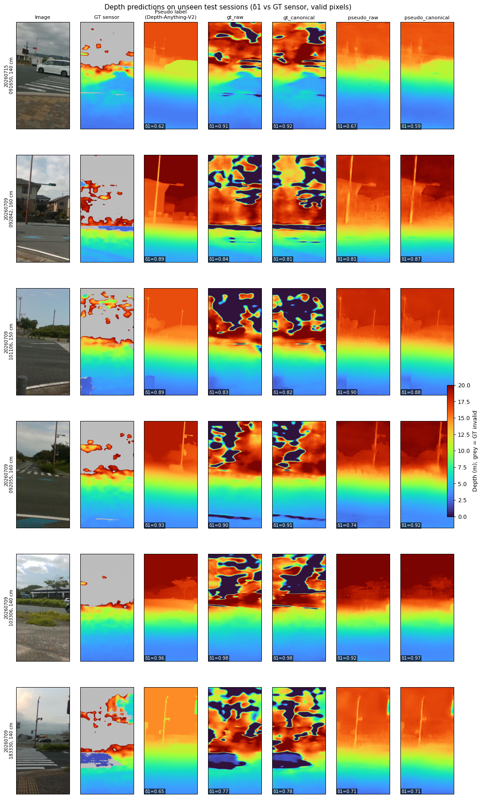
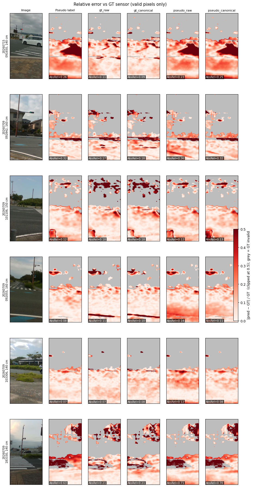
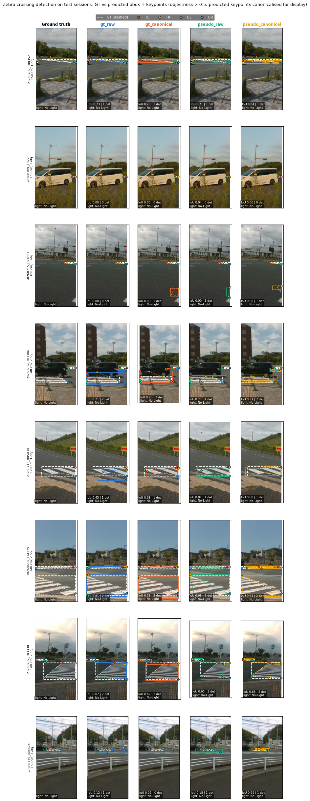
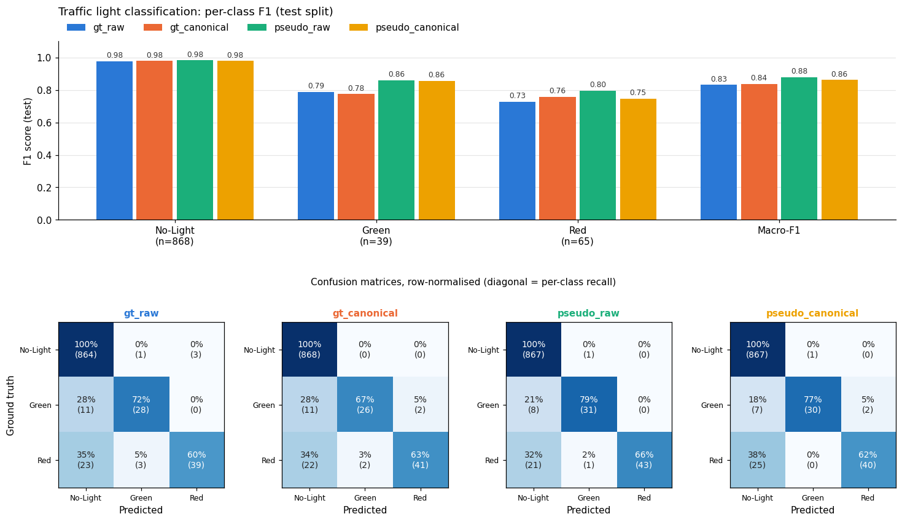

# Zebra-Crossing Multi-Task Network: v3 Experiment Summary

[English](#english) | [日本語](#日本語)

---

## English

### 1. Goal
A lightweight multi-task network (`model.py`, `MultiTaskNet`) for pedestrian assistance from a phone camera (portrait, 512×256), targeting Android (ONNX → TFLite). From one image it predicts:

- **Metric depth** (UNet decoder, 0–20 m)
- **Zebra-crossing bbox + objectness** (up to 4 slots)
- **4 corner keypoints** per crossing
- **Traffic light state**: No-Light / Green / Red
- **Camera height**

### 2. Data (v3)
- 5,000 frames from the Roboflow COCO export (`Zebra Crossing Annotation Ver.2`), each with uint16-mm sensor depth (`depth&imu data baru november 3`). 3,600 crossing objects, 2,011 frames without a crossing. Camera heights are 120–160 cm.
- Image-to-depth sync verified by `frame_id`. **IMU is not used.**
- The split is **by recording session** (seed 42), so test sessions are never seen in training:

  | Split | Frames | Sessions |
  |---|---|---|
  | Train | 3,487 | 180 |
  | Val | 541 | 26 |
  | Test | 972 | 51 |

- Pseudo depth: Depth-Anything-V2-Large (relative), calibrated **per frame** to that frame's GT with a degree-2 polynomial. Mean calibration MAE is 1.28 m.

### 3. Experiment design (2×2 grid)

| | Keypoints `raw` (annotation order) | Keypoints `canonical` (TL, TR, BL, BR) |
|---|---|---|
| **Depth `gt`**: loss on sensor depth, valid pixels only | `gt_raw` | `gt_canonical` |
| **Depth `pseudo`**: loss on Depth-Anything pseudo labels, all pixels | `pseudo_raw` | `pseudo_canonical` |

- **Canonical corner order** (`kpt_order.py`):
  1. Sort the 4 points clockwise around their centroid.
  2. The top edge is the adjacent pair with the smallest mean y; its left end is TL.
  3. Output order is [TL, TR, BL, BR].

  Raw annotations follow a consistent TL/TR/BL/BR order in only ~70% of objects. The common bbox-center quadrant rule fails on 79.9% of objects. The edge-based rule never produces a twisted quad, but ~42% of objects are inherently ambiguous: nearly flat top edge, near-duplicate corners, or corners on the image border.
- Common settings: `efficientnet_b0`, SoftDelta depth loss, L1 + CIoU bbox loss, 50 epochs, batch 32, AdamW + OneCycle (lr 3e-4), single seed 42.
- Evaluation is on the test split. Depth is **always** compared to GT sensor depth (valid pixels, 0.5–20 m).

### 4. Results (test split)

**Depth vs GT sensor**

| Model | δ1 ↑ | AbsRel ↓ | RMSE (m) ↓ | 0–5 m δ1 ↑ | Holes predicted < 2 m ↓ |
|---|---|---|---|---|---|
| gt_raw | **0.770** | 0.215 | 2.79 | **0.846** | 33.5% |
| gt_canonical | **0.770** | 0.211 | 2.78 | 0.843 | 33.8% |
| pseudo_raw | 0.704 | 0.260 | 2.26 | 0.711 | **0.0%** |
| pseudo_canonical | 0.706 | 0.264 | 2.27 | 0.706 | **0.0%** |
| *Teacher (pseudo label itself)* | 0.766 | 0.202 | 2.02 | 0.764 | – |

**Detection, keypoints, traffic light**

| Model | bbox IoU ↑ | kpt err (px) ↓ | PCK@10px ↑ | Light acc | Light bal-acc ↑ | Light macro-F1 ↑ |
|---|---|---|---|---|---|---|
| gt_raw | 0.483 | 41.8 | 0.187 | 0.958 | 0.771 | 0.832 |
| gt_canonical | 0.485 | 40.8 | 0.207 | 0.962 | 0.766 | 0.839 |
| pseudo_raw | 0.564 | 39.3 | 0.263 | **0.968** | **0.818** | **0.880** |
| pseudo_canonical | **0.596** | **35.2** | **0.320** | 0.964 | 0.794 | 0.862 |

Keypoint error is measured after canonicalizing both prediction and GT, so raw and canonical runs are compared fairly. Light test support: No-Light 868, Green 39, Red 65.

Full tables (per zone, per corner, per-class P/R/F1, confusion matrices) are in [`results_v3_en.md`](results_v3_en.md).

### 5. Key findings
1. **Pseudo-trained students copy the teacher, including its errors.** Even with oracle per-frame calibration, the teacher reaches only δ1 0.766. Pseudo students stay below it (~0.705), and their error maps reproduce the teacher's error regions. For example, on the white-car frame the teacher scores δ1 0.62, the pseudo students 0.59–0.67, and the GT students 0.91.
2. **The teacher is weakest at close range (0–5 m).** This is the most important range for pedestrians: GT models reach δ1 0.85 there, pseudo models ~0.71.
3. **GT-trained models fail in sensor holes.** On pixels where the sensor gives no depth (sky, far objects, glossy surfaces), they predict < 2 m on ~34% of pixels. Pseudo models predict 0% there. The two supervision sources have **complementary** weaknesses.
4. **Pseudo depth helps the other heads.** bbox IoU rises from 0.48 to 0.56–0.60, and light balanced accuracy from 0.77 to 0.79–0.82. A plausible reason is denser, smoother depth supervision giving better shared features.
5. **Canonical corner order helps when paired with pseudo depth.** Keypoint error drops from 39.3 to 35.2 px and PCK@10 rises from 0.26 to 0.32, with no keypoint collapse (spread ≈ 1.0). With GT depth the gain is small.
6. **Traffic light:** errors are mostly missed lights predicted as No-Light, not Green↔Red swaps. Red recall (60–66%) is the weakest. Data is limited, and with 39 Green test frames one frame equals 2.6 points.
7. **Detection** works well on near crossings. It misses far or small crossings at the image border and sometimes merges two adjacent crossings into one box.

### 6. Figures

| Depth predictions | Error maps (AbsRel vs GT) |
|---|---|
|  |  |

| Detection (GT white dashed, prediction colored) | Traffic light F1 + confusion matrices |
|---|---|
|  |  |

### 7. Next steps
- **GT + pseudo (fill-only)**: GT depth on valid pixels, with the teacher filling only the sensor holes (`teacher_fill_only=True` in `train.py`). This targets findings 1–3 together.
- A permutation-invariant ("matched") keypoint loss for ambiguous corners.
- Traffic-light head: class weighting or label smoothing, no hue jitter, and a higher-resolution light branch.
- Multiple seeds to measure variance.

### 8. Reproduce
Environment: conda env `shimo_ml` (Python 3.10, torch 2.5.1, timm 1.0.19, transformers 4.56.1).
```bash
python prepare_v3.py        # extract zips -> ds_v3/, build dataset_v3.csv (session split)
python make_teacher_v3.py   # Depth-Anything-V2-Large pseudo labels + per-frame calibration
python train_v3.py          # train the 2x2 grid, test eval -> eval_results_v3.csv
python evaluate_v3.py       # re-evaluate all checkpoints/v3_*_last.pt
python report_v3_en.py      # English report + figures -> results_v3_en.md, fig_v3_en_*.png
```
The datasets (`ds_v3/`, zip files) and checkpoints are not stored in this repository.

---

## 日本語

### 1. 目的
スマートフォンカメラ画像（縦向き 512×256）から歩行者支援を行う、軽量なマルチタスクネットワーク（`model.py` の `MultiTaskNet`）です。Android への展開（ONNX → TFLite）を想定しています。1枚の画像から以下を推定します。

- **メトリック深度**（UNet デコーダ、0–20 m）
- **横断歩道のバウンディングボックスと objectness**（最大4スロット）
- 横断歩道ごとの **4隅のキーポイント**
- **信号状態**：No-Light / Green / Red
- **カメラ高さ**

### 2. データ（v3）
- Roboflow の COCO エクスポート（`Zebra Crossing Annotation Ver.2`）の 5,000 フレームです。各フレームに uint16（mm）のセンサ深度（`depth&imu data baru november 3`）が付いています。横断歩道オブジェクトは 3,600 個で、横断歩道のないフレームが 2,011 枚あります。カメラ高さは 120–160 cm です。
- 画像と深度の同期は `frame_id` で確認済みです。**IMU は使用していません。**
- 分割は **記録セッション単位**（seed 42）で、テストのセッションは学習に一切含まれません。

  | 分割 | フレーム数 | セッション数 |
  |---|---|---|
  | Train | 3,487 | 180 |
  | Val | 541 | 26 |
  | Test | 972 | 51 |

- 擬似深度：Depth-Anything-V2-Large（相対深度）の出力を、**フレームごとに**そのフレームの GT に2次多項式でキャリブレーションしたものです。キャリブレーションの平均 MAE は 1.28 m です。

### 3. 実験設計（2×2 グリッド）

| | キーポイント `raw`（アノテーション順） | キーポイント `canonical`（TL, TR, BL, BR） |
|---|---|---|
| **深度 `gt`**：センサ深度で学習（有効画素のみ） | `gt_raw` | `gt_canonical` |
| **深度 `pseudo`**：Depth-Anything 擬似ラベルで学習（全画素） | `pseudo_raw` | `pseudo_canonical` |

- **正規化した角の順序**（`kpt_order.py`）：
  1. 4点を重心まわりに時計回りに並べます。
  2. 平均 y が最小の隣接ペアを上辺とし、その左端を TL とします。
  3. 出力順は [TL, TR, BL, BR] です。

  元のアノテーションで TL/TR/BL/BR の順が一貫しているのは約70%だけです。よく使われる「bbox 中心による象限判定」は 79.9% のオブジェクトで失敗します。辺ベースの方法ではねじれた四角形は生じませんが、約42%のオブジェクトは本質的に曖昧です（上辺がほぼ水平、角がほぼ重複、または角が画像端にある）。
- 共通設定：`efficientnet_b0`、SoftDelta 深度損失、L1 + CIoU の bbox 損失、50 エポック、バッチ 32、AdamW + OneCycle（lr 3e-4）、seed 42 の1回のみ。
- 評価はテスト分割で行います。深度は**常に** GT センサ深度と比較します（有効画素、0.5–20 m）。

### 4. 結果（テスト分割）

**深度（GT センサとの比較）**

| モデル | δ1 ↑ | AbsRel ↓ | RMSE (m) ↓ | 0–5 m δ1 ↑ | 欠損部で 2 m 未満と予測 ↓ |
|---|---|---|---|---|---|
| gt_raw | **0.770** | 0.215 | 2.79 | **0.846** | 33.5% |
| gt_canonical | **0.770** | 0.211 | 2.78 | 0.843 | 33.8% |
| pseudo_raw | 0.704 | 0.260 | 2.26 | 0.711 | **0.0%** |
| pseudo_canonical | 0.706 | 0.264 | 2.27 | 0.706 | **0.0%** |
| *教師（擬似ラベルそのもの）* | 0.766 | 0.202 | 2.02 | 0.764 | – |

**検出・キーポイント・信号**

| モデル | bbox IoU ↑ | キーポイント誤差 (px) ↓ | PCK@10px ↑ | 信号 正解率 | 信号 バランス正解率 ↑ | 信号 macro-F1 ↑ |
|---|---|---|---|---|---|---|
| gt_raw | 0.483 | 41.8 | 0.187 | 0.958 | 0.771 | 0.832 |
| gt_canonical | 0.485 | 40.8 | 0.207 | 0.962 | 0.766 | 0.839 |
| pseudo_raw | 0.564 | 39.3 | 0.263 | **0.968** | **0.818** | **0.880** |
| pseudo_canonical | **0.596** | **35.2** | **0.320** | 0.964 | 0.794 | 0.862 |

キーポイント誤差は、予測と GT の両方を正規化順に並べ替えてから測っています。そのため raw と canonical を公平に比較できます。信号のテスト件数は No-Light 868、Green 39、Red 65 です。

全ての表（距離帯別、角ごと、クラス別 P/R/F1、混同行列）は [`results_v3_en.md`](results_v3_en.md) にあります。

### 5. 主な知見
1. **擬似ラベルで学習したモデルは、誤りも含めて教師をそのまま模倣します。** フレームごとの理想的なキャリブレーションを使っても、教師の δ1 は 0.766 にとどまります。擬似ラベルで学習したモデルはそれを下回り（約 0.705）、誤差マップも教師と同じ領域で誤っています。たとえば白い車のフレームでは、教師が δ1 0.62、pseudo モデルが 0.59–0.67、GT モデルが 0.91 です。
2. **教師は近距離（0–5 m）が最も弱いです。** 歩行者にとって最も重要な範囲で、GT モデルは δ1 0.85、pseudo モデルは約 0.71 です。
3. **GT で学習したモデルはセンサの欠損部で破綻します。** センサが深度を返さない画素（空、遠方物体、光沢面）の約34%で 2 m 未満と予測します。pseudo モデルではこれが 0% です。2つの教師信号は**相補的な**弱点を持っています。
4. **擬似深度は他のヘッドの性能を向上させます。** bbox IoU は 0.48 から 0.56–0.60 に、信号のバランス正解率は 0.77 から 0.79–0.82 に上がります。密で滑らかな深度教師信号によって、共有特徴が良くなったためと考えられます。
5. **正規化した角の順序は、擬似深度と組み合わせたときに有効です。** キーポイント誤差は 39.3 から 35.2 px に下がり、PCK@10 は 0.26 から 0.32 に上がります。キーポイントの崩壊もありません（spread ≈ 1.0）。GT 深度との組み合わせでは改善は小さいです。
6. **信号：** 誤りの多くは信号の見逃し（No-Light と予測）で、Green と Red の取り違えではありません。Red の再現率（60–66%）が最も低いです。データ量が少なく、テストの Green は 39 枚しかないため、1枚で 2.6 ポイント変わります。
7. **検出**は近くの横断歩道ではうまく機能します。画像端にある遠方や小さな横断歩道は見逃しやすく、隣接する2つの横断歩道を1つの箱にまとめてしまうこともあります。

### 6. 図

| 深度予測 | 誤差マップ（GT に対する AbsRel） |
|---|---|
|  |  |

| 検出（GT：白破線、予測：色付き） | 信号の F1 と混同行列 |
|---|---|
|  |  |

### 7. 今後の課題
- **GT + 擬似ラベル（欠損補完のみ）**：有効画素では GT 深度を使い、教師はセンサ欠損部だけを補完します（`train.py` の `teacher_fill_only=True`）。知見 1–3 にまとめて対処できます。
- 曖昧な角に対応する、並べ替え不変（matched）のキーポイント損失。
- 信号ヘッドの改善：クラス重み付けや label smoothing、色相ジッタの除去、高解像度の信号ブランチ。
- 複数シードによる分散の評価。

### 8. 再現手順
環境：conda env `shimo_ml`（Python 3.10、torch 2.5.1、timm 1.0.19、transformers 4.56.1）。
```bash
python prepare_v3.py        # zip を ds_v3/ に展開し、dataset_v3.csv を作成（セッション単位で分割）
python make_teacher_v3.py   # Depth-Anything-V2-Large 擬似ラベル + フレームごとのキャリブレーション
python train_v3.py          # 2x2 グリッドを学習し、テスト評価 -> eval_results_v3.csv
python evaluate_v3.py       # checkpoints/v3_*_last.pt を全て再評価
python report_v3_en.py      # 英語レポートと図 -> results_v3_en.md, fig_v3_en_*.png
```
データセット（`ds_v3/` と zip ファイル）とチェックポイントはこのリポジトリには含めていません。
